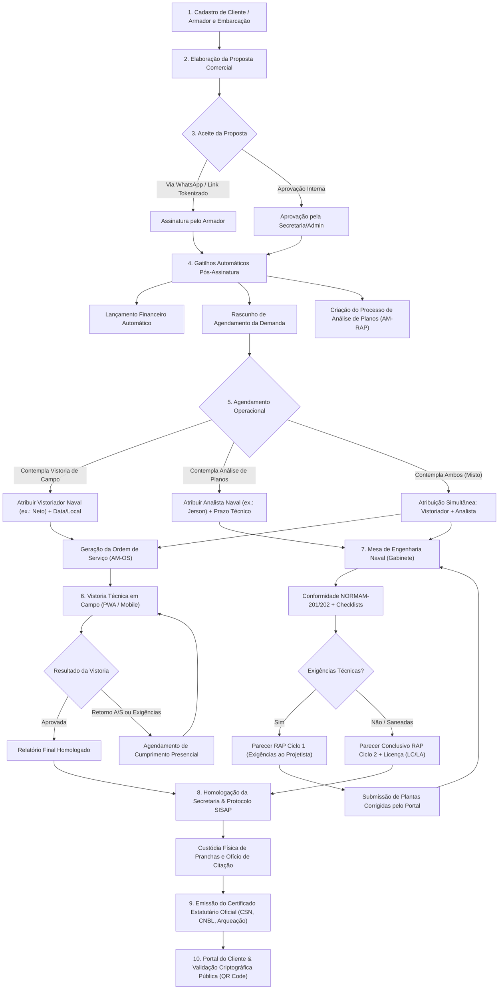

# Manual do Fluxo Operacional Ponta a Ponta — Sistema Amazon Naval

> **Documento Oficial de Engenharia, Regras Operacionais e Usabilidade Naval**  
> **Versão:** 2.0 (Novembro/2026)  
> **Pilares Regulatórios Mandatórios:** NORMAM-201, NORMAM-202, NORMAM-211, NORMAM-212 (DPC/Marinha do Brasil), NPCP/NPCF e RIPEAM.  
> **Delimitação:** Escopo 100% voltado à segurança da navegação e operação naval brasileira (sem sobreposição com ISO/SGQ).

---

## Sumário Executivo
Este documento descreve detalhadamente o fluxo de operação do sistema, desde o primeiro contato comercial e cadastros de clientes e embarcações, passando pela contratação de serviços, agendamentos dedicados, execução de vistorias técnicas navais em campo, análise técnica de planos por engenharia naval, custódia de protocolos, até a emissão oficial de certificados estatutários e licenciamento perante a Capitania dos Portos.

---

## 1. Visão Geral da Arquitetura e Matriz de Perfis

O sistema opera no modelo multiusuário com controle rigoroso de papéis e responsabilidades técnicas navais:

| Cargo / Perfil | Responsabilidades Principais no Sistema | Painel / Dashboard Principal |
| :--- | :--- | :--- |
| **`ADMIN`** | Diretoria Técnica, gestão global, homologação final, delegações e auditoria criptográfica. | `/dashboard` (Central de Comando) |
| **`SECRETARIA`** | Recepção de demandas, aprovação interna de propostas, despacho administrativo, emissão de ofícios e geração de certificados. | `/dashboard` (Painel Administrativo) |
| **`VENDEDOR`** | Prospecção comercial, cadastro de clientes/armadores, cadastro de embarcações, criação e envio de orçamentos/propostas. | `/dashboard` (Painel Comercial) |
| **`VISTORIADOR`** | Engenheiro/Vistoriador Naval credenciado que realiza a inspeção técnica presencial na embarcação (casco, salvatagem, combate a incêndio, máquinas). | `/dashboard` (Minha Operação) e `/campo` (PWA Offline) |
| **`ANALISTA`** | Engenheiro Naval de gabinete responsável pela análise de projetos, estabilidade, planos de segurança, pareceres técnicos (RAP) e licenças de construção/alteração. | `/dashboard` (Mesa de Engenharia Naval) |
| **`CLIENTE / ARMADOR`**| Armador, proprietário ou despachante credenciado. Aceite formal de propostas, upload de pranchas náuticas e consulta de certificados via portal web protegido. | `/portal` (Portal do Cliente) |

---

## 2. Macrofluxo Operacional Ponta a Ponta

O diagrama abaixo ilustra o ciclo de vida completo de uma demanda no sistema:

---

## 3. Detalhamento Etapa por Etapa

### Etapa 1: Cadastros Fundamentais (Clientes e Embarcações)
* **Rotas do Sistema:** `/clientes`, `/clientes/form`, `/embarcacoes`, `/embarcacoes/form`
* **Como Funciona:**
  1. O operador comercial cadastra o **Cliente** (Pessoa Física ou Jurídica), informando CPF/CNPJ, Razão Social/Nome, telefone (com WhatsApp para avisos automáticos) e e-mail.
  2. O cliente pode ser marcado como **Armador**, habilitando a seleção deste armador em formulários operacionais.
  3. A **Embarcação** é cadastrada com seu nome náutico, número de inscrição na Capitania dos Portos (TIE/PRPM), tipo de embarcação (Empurrador, Balsa, Passageiro, Carga Geral, Lancha), tipo de navegação (Interior / Mar Aberto) e arqueação bruta (AB).
  4. O sistema vincula automaticamente a embarcação ao cliente proprietário.

---

### Etapa 2: Catálogo de Serviços Naval
* **Rota do Sistema:** `/servicos`
* **Como Funciona:**
  1. O catálogo de serviços contém os serviços técnicos padronizados da certificadora, divididos entre:
     - **Vistorias de Campo:** Vistoria Inicial Flutuando, Vistoria Inicial Seco, Vistoria Anual, Vistoria Especial NORMAM-202, Borda Livre, Arqueação.
     - **Análise Técnica de Planos (Gabinete):** Análise de Planos Ec1 (`ANALISE_PLANOS_EC1`) e Análise de Planos Ec2 (`ANALISE_PLANOS_EC2`).
     - **Acompanhamentos Técnicos:** Acompanhamento de Ultrassom, Prova de Inclinação, Teste de Tração Estática (Bollard Pull).
  2. Cada serviço possui seu preço padrão em reais, passível de desconto negociado no momento da proposta.

---

### Etapa 3: Proposta Comercial, Orçamento e Aceite
* **Rotas do Sistema:** `/propostas`, `/propostas/form`, `/propostas/visualizar`, `/propostas/assinar`
* **Como Funciona:**
  1. O Vendedor ou Secretaria cria a proposta comercial vinculando o Cliente e uma ou mais Embarcações.
  2. São adicionados os serviços náuticos contratados, informando valores negociados, condições de pagamento e dados do responsável pelo fechamento.
  3. **Envio ao Cliente:** O sistema gera um link tokenizado único compartilhável via WhatsApp ou e-mail. O Armador abre o documento digitalmente estilizado e pode assinar pelo celular ou computador.
  4. **Aprovação Interna:** Caso o cliente prefira autorizar presencialmente ou por ofício/e-mail, a Secretaria ou o Administrador pode efetuar a **Aprovação Interna** com 1 clique.
  5. **Disparos Automáticos Imediatos:**
     - Gera o lançamento financeiro em contas a receber (`financeiro_lancamentos`).
     - Gera o rascunho de agendamento operacional pré-preenchido (`agendamentos`).
     - Se houver serviço de Análise de Planos (Ec1 ou Ec2), gera automaticamente o processo técnico (`analises_planos` com numeração `AM-RAP-X/26`), semeia o checklist correspondente da NORMAM-202 e notifica a equipe técnica.

---

### Etapa 4: Agendamento Inteligente e Atribuição de Responsáveis
* **Rotas do Sistema:** `/agendamentos`, `/agendamentos/form`
* **Como Funciona:**
  1. A Secretaria ou Administrador abre a tela de Agendamento. O sistema detecta automaticamente a proposta vinculada e os tipos de serviços envolvidos.
  2. **Identificação Inequívoca:** Os profissionais são exibidos sempre com **Nome e E-mail**, prevenindo atribuições incorretas:
     - `Neto (neto@amazonnaval.com.br) (Qualificado)` — Vistoriador Naval.
     - `Jerson da Silva Almeida (jersonalmeida.tec@hotmail.com)` — Analista Naval.
  3. **Suporte aos 3 Modelos de Demanda:**
     - **Apenas Vistoria em Campo:** O formulário exibe o bloco de campo. A Secretaria seleciona o Vistoriador credenciado, data, hora e porto/estaleiro.
     - **Apenas Análise de Planos:** O bloco de vistoria de campo é desativado; o formulário exige apenas a seleção do Analista Naval e a data limite para emissão do parecer.
     - **Proposta Mista:** Ambos os blocos são ativados. A Secretaria define quem vai a bordo da embarcação e quem fará a análise das plantas em gabinete.
  4. **Confirmação do Agendamento:**
     - Quando houver vistoria de campo, gera automaticamente a **Ordem de Serviço (OS)** oficial com número sequencial (`AM-OS-X/26`), disponibilizada imediatamente no aplicativo do Vistoriador.
     - Para a análise de planos, a demanda é marcada como `AGENDADA` e surge instantaneamente na fila de trabalho do Analista.

---

### Etapa 5: Vistoria Técnica Naval em Campo (Vistoriador)
* **Rotas do Sistema:** `/vistorias`, `/vistorias/relatorio`, `/campo` (PWA Offline)
* **Como Funciona:**
  1. O Vistoriador abre o aplicativo de campo no celular ou tablet. O aplicativo funciona inclusive sem sinal de internet (offline), sincronizando ao reconectar.
  2. **Inspeção Presencial:** O vistoriador confere os itens de arqueação, borda livre, casco, fundo duplo, praça de máquinas, quadro elétrico, luzes e marcas de navegação (RIPEAM), coletes salva-vidas, boias circulares, balsas e extintores de incêndio (NORMAM-202/211).
  3. **Registro Fotográfico:** Captura de fotos obrigatórias dos equipamentos, placas de identificação e pontos críticos.
  4. **Emissão do Relatório de Vistoria:**
     - **APROVADA:** Embarcação conforme; segue para emissão de certificado.
     - **APROVADA COM EXIGÊNCIAS:** Pendências de fácil regularização que não impedem a operação imediata.
     - **RETORNO A/S:** Exigência de Advertência/Segurança com prazo fixado. O sistema bloqueia a aprovação direta e agenda automaticamente a vistoria de retorno para verificação de cumprimento.

---

### Etapa 6: Análise Técnica de Planos e Engenharia Naval (Analista)
* **Rotas do Sistema:** `/analises-planos`, `/analises-planos/form`, `/analises-planos/parecer`
* **Como Funciona:**
  1. O Analista Naval (ex.: Jerson) acessa sua **Mesa de Engenharia Naval**.
  2. Na tela do processo (`AM-RAP-X/26`), ele visualiza a documentação técnica enviada pelo armador/projetista:
     - Memorial Descritivo da Construção/Alteração.
     - Plano de Arranjo Geral e Linhas.
     - Plano de Segurança e Combate a Incêndio.
     - Estudo de Estabilidade e Curvas Hidrostáticas (com ART do Engenheiro Responsável pelo projeto).
  3. **Checklist Normativo:** O sistema gera automaticamente os itens auditáveis conforme a NORMAM-201 ou NORMAM-202 (Classe EC1 ou EC2).
  4. **Gestão de Exigências Técnicas:**
     - Se houver divergências nos cálculos ou pranchas, o Analista cadastra a exigência referenciando o item exato da NORMAM (ex.: *NORMAM-202, Cap. 3, Item 3.4*).
     - Emite o **RAP Ciclo 1 (Relatório de Análise com Exigências)** assinado digitalmente.
     - O Armador é notificado pelo portal e providencia a retificação com seu engenheiro projetista.
  5. **Conclusão e Parecer Favorável:**
     - Saneadas as exigências, o Analista emite o **RAP Ciclo 2 (Parecer Conclusivo)** e gera a minuta da **Licença de Construção (LC)** ou **Licença de Alteração (LA)**.

---

### Etapa 7: Secretaria & Mesa de Despacho Oficial
* **Rotas do Sistema:** `/secretaria/dashboard`, `/secretaria/oficios`, `/vistorias/detalhe`
* **Como Funciona:**
  1. A Secretaria revisa os relatórios de vistoria enviados de campo e os pareceres de planos homologados.
  2. Gera o **Ofício de Citação / Encaminhamento** padronizado, endereçado à Capitania dos Portos, Delegacia ou Agência Fluvial jurisdicionante.
  3. Organiza os dados da embarcação e anexa a folha de rosto oficial com a numeração dos autos.

---

### Etapa 8: Protocolos & Dossiês Documentais (SISAP)
* **Rotas do Sistema:** `/protocolos`, `/protocolos/form`, `/protocolos/dossie`
* **Como Funciona:**
  1. **Custódia Física de Pranchas:** O sistema registra a entrada física das plantas em papel vegetal/offset ou arquivos digitais, indicando quem entregou, data/hora e armário/escaninho de guarda.
  2. **Trâmite SISAP:** Registro do número de protocolo oficial aberto no Sistema de Atendimento ao Público da Marinha do Brasil.
  3. **Histórico Auditável:** Cada movimentação (Envio à Capitania, Retirada para Ajuste, Devolução Aprovada) fica registrada com carimbo de tempo e usuário responsável.

---

### Etapa 9: Emissão de Certificados e Licenças Estatutárias
* **Rotas do Sistema:** `/certificados`, `/certificados/wizard`, `/certificados/visualizar`
* **Como Funciona:**
  1. Com o relatório de vistoria ou parecer de planos aprovado, a Secretaria ou Administrador abre o **Assistente de Emissão de Certificados**.
  2. O sistema pré-carrega automaticamente todas as características técnicas da embarcação e da vistoria.
  3. **Tipos de Certificados Emitidos:**
     - **CSN:** Certificado de Segurança da Navegação.
     - **CNBL:** Certificado Nacional de Borda Livre.
     - **Certificado de Arqueação (Nacional ou Simplificado).**
     - **Licença de Construção (LC) / Licença de Alteração (LA).**
  4. **Segurança Criptográfica:**
     - O PDF oficial é gerado com hash **SHA-256** imutável.
     - Inclui **QR Code** de validação pública.
     - O sistema calcula e monitora as datas de validade (vistorias anuais, intermediárias e renovação quinquenal), gerando alertas automáticos de vencimento.

---

### Etapa 10: Portal do Cliente / Armador e Validação Externa
* **Rotas do Sistema:** `/portal`, `/validar`
* **Como Funciona:**
  1. O cliente acessa o **Portal do Armador** com link seguro e tokenizado (sem burocracia de esquecimento de senha).
  2. No portal, o cliente:
     - Visualiza a linha do tempo de suas propostas, agendamentos e vistorias.
     - Faz upload das plantas náuticas e documentos solicitados pela equipe técnica.
     - Faz download dos seus Certificados e Licenças autenticados.
  3. **Validação Pública:** Qualquer autoridade da Capitania dos Portos, armador ou contratante pode escanear o QR Code de um certificado ou acessar `/validar`, conferindo em tempo real a autenticidade e validade jurídica do documento emitido.

---

## 4. Guia Rápido de Navegação e Atalhos Operacionais

| Se você precisa... | Acesse o módulo | Atalho |
| :--- | :--- | :--- |
| Cadastrar um novo cliente ou armador | **Clientes** | `/clientes/form` |
| Cadastrar uma nova balsa, empurrador ou lancha | **Embarcações** | `/embarcacoes/form` |
| Montar um orçamento e enviar ao armador | **Propostas** | `/propostas/form` |
| Marcar uma vistoria de campo ou análise de planos | **Agendamentos** | `/agendamentos/form` |
| Realizar uma vistoria a bordo de uma embarcação | **Vistorias** ou **App Campo** | `/vistorias` ou `/campo` |
| Analisar planos, estabilidade e emitir RAP | **Análise de Planos** | `/analises-planos` |
| Expedir ofícios para a Capitania dos Portos | **Secretaria** | `/secretaria/oficios` |
| Controlar pranchas físicas e protocolo SISAP | **Protocolos** | `/protocolos` |
| Emitir o certificado definitivo (CSN, CNBL, etc.) | **Certificados** | `/certificados/wizard` |
| Visualizar indicadores e pendências do dia | **Dashboard Geral** | `/dashboard` |

---

## 5. Garantia de Preservação e Boas Práticas
- **Usabilidade Autodidática:** Todo formulário operacional possui orientações em texto cinza abaixo do campo (`<small class="text-muted">`), instruindo claramente qual dado preencher e qual norma fundamenta a exigência.
- **Identificação Clara de Usuários:** Nunca selecionar contas genéricas ou de teste; use sempre as opções contendo o e-mail oficial (`neto@amazonnaval.com.br`, `jersonalmeida.tec@hotmail.com`).
- **Idempotência Operacional:** Propostas assinadas não geram agendamentos duplicados; ao alterar dados da proposta ou de agendamentos pendentes, o sistema preserva a unicidade da ordem de serviço.
